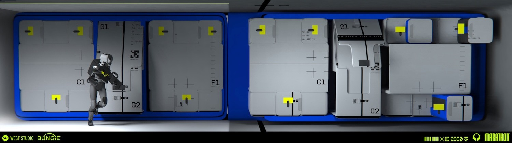
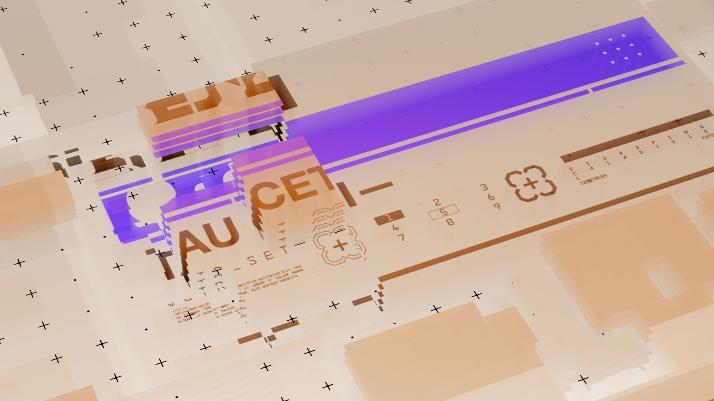
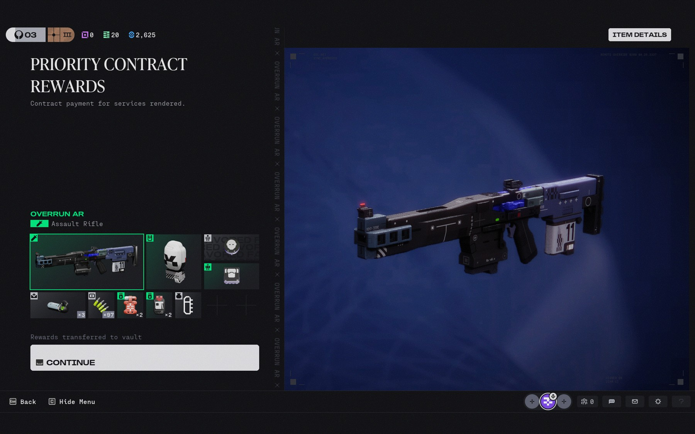
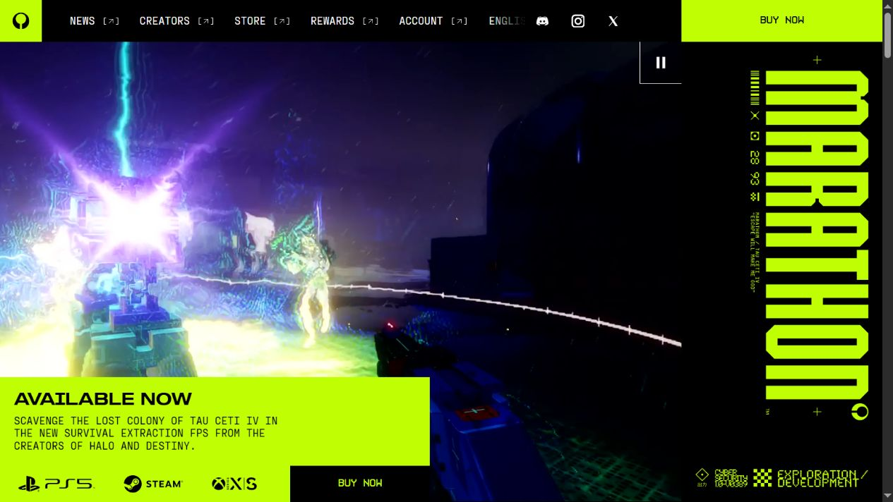
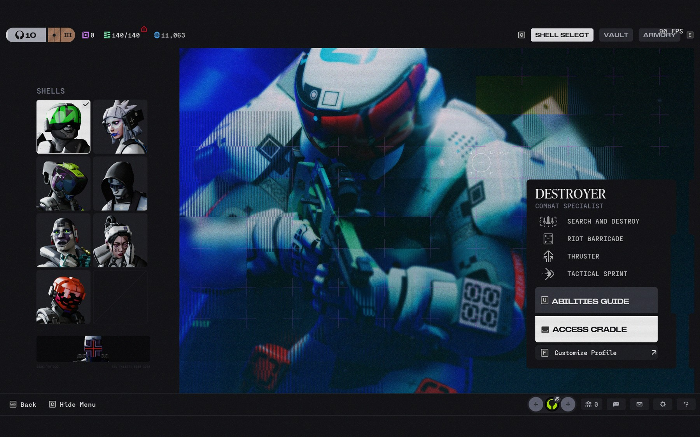
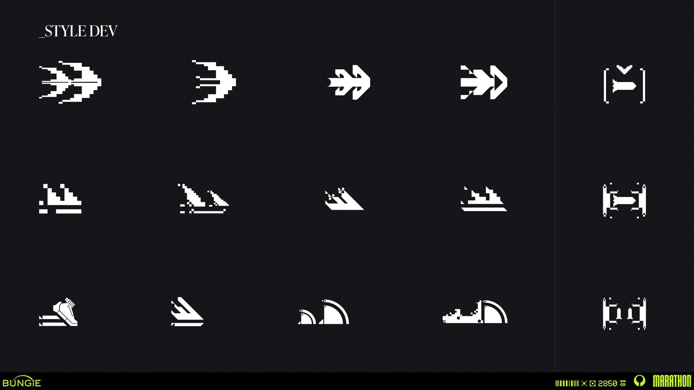
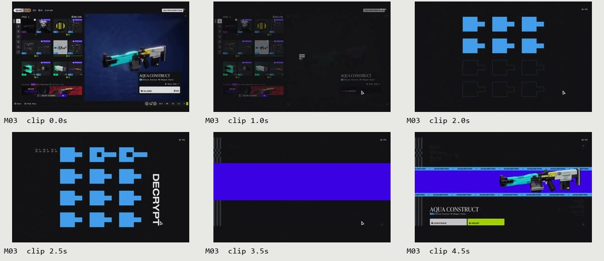
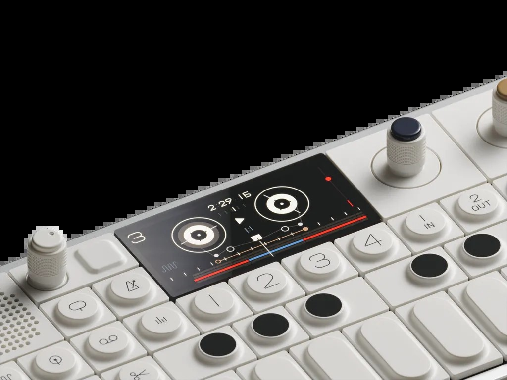
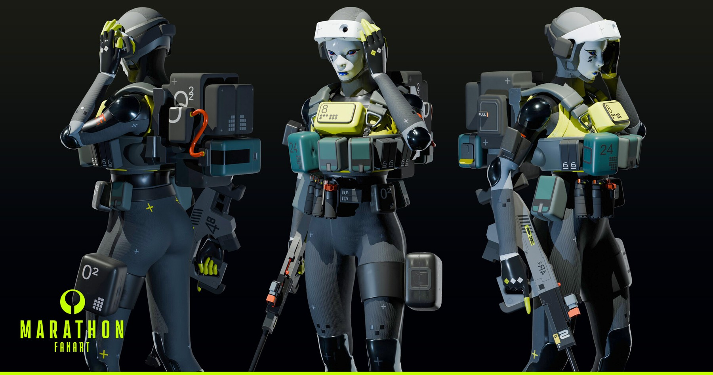

# Marathon：从图形写实主义到工作室界面

研究日期：2026-11-07。范围为公开可取得的官方站点、制作方资料、实机归档、影片、分析、二创与跨领域参考。当前成果包含研究、设计体系建议与试点；全面设计尚未获批。

可浏览版本：[研究图册](../index.html) · [交互试点](../prototypes/index.html) · [来源索引](../sources/INDEX.md) · [24 个案例的结构化记录](cases.json)。

## 1. 核心判断

适合本项目的转译方向是：**有功能依据的几何结构、清楚的字阶反差、集中使用的高饱和色，以及能够解释状态的短动效**。图像创作和管理任务需要持续阅读，作品本身又需要准确的观看环境，所以风格应分配到不同区域，而不是平均覆盖每个像素。

“Graphic Realism”首先描述一种造型与表现策略。2023 年 Joseph Cross 的论述，经 Creative Bloq 引述，分别强调简化／解构的设计语言、强烈图形与色彩、有限材质，以及可信的比例、尺度、功能暗示和世界。2026 年 Art Blast 中，Brian Vinton 与 Jason Sussman 又将产品设计的可信度、图形设计的鲜明度和 Marathon 的陌生感并列，并明确提到负空间、色彩节制、材料关系与隐含功能。[S04、S12]

这使研究的重点超出了“科幻、荧光绿、故障效果”几个标签：同一视觉体系可以同时容纳白色工业外壳、低彩度控制面板、极高饱和图形、自然植被、合成身体和磨损。它的统一性来自形体、信息与功能之间的关系。

*West Studio 的环境概念设计：浅色体块、蓝色结构、局部黄色和人物尺度共同说明系统关系。来源 S15；不是官方 UI 尺寸规范。*

## 2. 将四种视觉场景分开理解

| 场景 | 首要目标 | 观察到的手法 | 适配到工作室 |
| --- | --- | --- | --- |
| 官网、海报与品牌传播 | 在短时间建立身份与兴趣 | 强色块、大字、极端尺度差、边缘微排版、影像 | 侧栏身份区、空状态、局部主标题、主操作 |
| 游戏中的可操作 UI | 选择、比较、确认与反馈 | 选择列表、物品网格、预览区、信息面板、主动作 | 图库、批量归类、图片详情、模型与参数区域 |
| 片中虚构屏幕 | 叙事、机器感、系统状态 | 失真、编码、扫描、层叠色块、不稳定的可读性 | 少量短暂装饰与状态转换；操作文字保持稳定 |
| 场景、角色与 CG | 建立可信又陌生的世界 | 简化大体块、材料对比、工业标记、真实光照与尺度 | 组件轮廓和插图方向；不把电影光照当作控件色值 |

Michael Rigley 在自己的制作说明中明确区分了片中界面与场景贴花，并指出信号中断、压缩、噪声和不稳定信息属于叙事的一部分。该资料对应 2023 公告片，不能自动成为当前游戏的交互规范。[S41]

*网格、坐标与块状结构带来身份；信息失真在这个场景中具有叙事理由。工作室的提示词、费用、状态和错误原因承担的是直接操作职责。*

## 3. 字体：先定义角色，再选择字库

字体证据来自两个层次：当前官网实际渲染的 CSS 声明，以及 Fonts In Use 对 2026 游戏截图的整理。后者是社区归档，作者判断与官方声明分别记录。

| 字体／声明 | 已核实到的证据 | 可借鉴的特征 | 项目处理 |
| --- | --- | --- | --- |
| KH Interference | 官网购买按钮声明 `khInterference`；Fonts In Use 的实机归档；KH Type 官方说明 | 大写等宽展示字、45° 网格、外角圆／内角直、紧密的行距、符号系统 | 适合短展示字和标识；没有中文支持证据，不承担长正文 |
| 定制 Shapiro | 官网标题声明 `marathonShapiro`；归档描述为修改过的 Shapiro Wide 65 | 宽体、较大的视觉面积与直接标题节奏 | 用于研究字阶和密度；样张采用本机字体替代，未复制商业字体文件 |
| Fraktion Mono | 官网导航／部分标签声明 `ppFraktionMono`；实机归档记录 Regular／Medium | 数据感、固定字宽、数字与编码的节奏 | 只把这种角色分配给编号、参数、状态辅助信息 |
| IvyPresto Headline | Fonts In Use 对实机标题的辨认 | 编辑式、较柔和的衬线气质，与工业图形形成反差 | 可以影响少量展示文字；普通操作标签仍保持统一 |

KH Type 官方说明提供了尤其有用的结构依据：Interference 的几何不是简单的“所有角都切掉”，其外部圆角与内部直角并存，另有支持紧行距的重音字形替换。这说明风格来自一组相互协调的规则。[S20]

中文需要独立成立。推荐把字阶分成展示、操作、数据三个角色：中文正文与按钮使用可靠的无衬线字体；数字／编号使用等宽或等宽数字；衬线仅用于少量展示文字。思源黑体／思源宋体及 Space Grotesk／Space Mono 是可进一步测试的开源候选，有各自的源仓库与许可说明，但都不等同于游戏原字库。[S40、S42–S44]

本轮 FigCraft 与浏览器试点使用 Microsoft YaHei UI、Arial、Consolas、Georgia，便于在当前环境中保持可编辑与一致显示。**这些是明确标记的试点替代字体**；正式字体决策还需要双语样张、许可和部署体积的验证。

## 4. 颜色：品牌信号与语义颜色分别管理

当前官网 BUY NOW 按钮的实际背景为 RGB(192,254,4)，即 **#C0FE04**，搭配黑色文字。这一值有浏览器样式读取依据。其他概念图和电影画面的颜色受到材质、光照和视频压缩影响，只作为色彩关系参考。[S01]

工作室建议建立三层颜色：

1. 基础面：背景、表面、浮层、侧栏和图片舞台，保证阅读与看图。
2. 品牌强调：酸绿色及有限的次级颜色，服务主动作、选择和品牌锚点。
3. 业务语义：成功、警告、错误、禁用和键盘焦点，具有稳定含义，并配合文字或形状。

试点浅色主题采用灰白／灰绿基底，深色主题采用低彩度近黑基底。浅色下的小字号强调文字使用更深的绿色，亮绿用于填充并配深色文字；深色下亮绿可用于小面积标记。两套主题共享变量名，但分别选择背景层级、边界、遮罩和文字值。具体值与对比检查见 [基础规范](../system/foundations.md) 和 [tokens.json](../system/tokens.json)。

官方材料中的高彩度蓝、紫、洋红、青绿与橙色值得保留为探索空间，但本项目的“错误”“处理中”“选中”不应随着视觉主题随意换义。对图片展示区，强色边框和持续闪动尤其需要克制，因为会影响对作品明暗、色相和细节的判断。

## 5. 布局、形态与图标

官网与传播图采用大尺度差：主标题与主体图像决定首要阅读，小号编码被安排到边缘或局部区域。可操作 UI 则经常把列表、主体预览、说明和动作分开。两种方式都依靠层级，而不是依靠每个元素同样显眼。[S01、S02、S11]

工作室的布局原则是：创作区围绕“输入—参数—费用—发送—结果”组织，图库围绕“浏览—选择—归类—预览”组织。侧栏说明当前位置，弹窗聚焦一个决定，表格帮助比较记录。所有视觉手法都需要服从这条任务顺序。

形态上同时保留直线、小圆角、有限切角与模块化组合。试点比较了 8px、0px、3px 三种圆角表达；这些数值是工作室建议，不是官方参数。控件与内容容器可使用不同的边界强度，不能仅为装饰在每个角上增加十字、编码或边框。

Ryan Klaverweide 的图标资料提供了比单张最终图更有用的证据：同一含义的轮廓迭代、线与块的比例、以及可以复用的基本图形。工作室需要自己的下载、添加、文件夹、选择、关闭等符号，首先在 16／20／24px 中辨认清楚，再考虑风格细节。[S13]

## 6. 动效：区分反馈、空间变化与叙事

本轮保留 12 组短片与连续帧，覆盖实机 UI、Antibody 公开短预览、Michael Rigley 的网页循环及官方 CG 的选定片段。每组标记来源、采样位置和范围。公开短预览不充当完整影片观看记录；连续帧的采样间隔也不是原控件的交互时长。

最值得转译的是“变化有明确起点与稳定终点”。实机奖励展示可以经过块阵、文字、色带再落到结果；但频繁生图操作需要更短、局部的反馈。建议把动效分成：按钮即时反馈、组件状态变化、弹窗／抽屉的空间进入，以及少量品牌表达。[S11、S38]

本轮产品建议采用 120／180／240／320ms 四档，位移主要为 1／4／8px，缓动暂定 `cubic-bezier(0.2,0,0,1)`。这些是试点参数，未声称从游戏测得。生成中使用无百分比的状态指示，成功结果及时呈现，部分失败保留成功图；失败与中断仍由现有业务规则决定，不增加自动重试。

减少动态效果时保留状态文字、焦点和操作结果，去掉位移与循环运动。错误信息不会用乱码或故障闪烁表达。详细触发、打断和降级规则见 [动效规范](../system/motion.md)。

## 7. 扩展参考与二创如何进入体系

| 参考 | 可以借鉴 | 在本研究中的证据边界 |
| --- | --- | --- |
| The Designers Republic / WipEout | 主身份、虚构子品牌、图标与版式的系统关系 | Cross 的影响论述经 S04 转述；项目作者归属在 S31 核对。视频 S08 的图像属于二级比较材料 |
| teenage engineering / OP–1 field | 有色编码、稳定位置、硬件控制与显示区的分工 | 第一方产品资料与照片；作为本研究比较对象，不宣称该具体产品是官方影响源 |
| Nike Podium / Kurppa Hosk | 共享基础变量支撑多种表达，字体／颜色／动效协同 | 第一方案例说明，不借用 Nike 专有资产和具体数值 |
| Dieter Rams / Vitsœ | 结构解释用途、诚实反馈、日常使用的持久性 | 原则及产品图来自第一方资料；用于约束操作成本，同时保留风格表达 |
| Rémy Mallard 的 Marathon 二创 | 塑料感、几何比例、有限鲜色、工业标记如何共同维持身份 | 作者明确标为 fan art；不冒充官方资产 |
| 科幻影像、赛车、音乐和平面设计 | 尺度、材料、身体与机器、编号和视觉节奏 | 由制作论述和分析视频提供线索；具体影响关系需要独立证据，不能仅凭相似外观认定 |

跨领域研究最有价值的结果，是让规则能够处理新的组件。一个只会复用海报或游戏符号的方案，很难设计管理表格、价格冲突、长中文输入或滑动条；结构、层级、语义颜色和状态规则则能够继续工作。

## 8. 三种试点方向与建议

| 方向 | 主要表达 | 适用性与代价 |
| --- | --- | --- |
| A / FIELD · 理性工业 | 较柔和的模块轮廓、清楚的工程式排版、小面积强调 | 阅读稳定、适配成本较低；品牌性相对含蓄 |
| B / SIGNAL · 强烈图形 | 明亮标题色块、方形边界、大字与明显标记 | 辨识度强；需要限制高饱和区域面积，检查长时间使用 |
| C / STUDIO · 混合表达 | 技术信息与少量衬线展示形成反差，主动作和导航承担强调 | 更适合创作工作室的内容密度；仍需在正式字库和组件细节中加强个性 |

建议以 **C 作为工作界面的起点**，保留 B 作为更强烈的候选，待实际试用和用户审阅后决定。这个建议依据目前的中文内容、双主题与操作验证，不是用户偏好研究或 A/B 实验结果。

试点提供相同内容的三方向双主题创作画面、双主题图库多选、组件状态板和窄屏画面。浏览器演示支持主题／方向切换、弹窗、名称检查、六附件上限、图片预览、图库多选、滑动条、生成状态与减少动态效果。它使用本地示例数据，不代表已接入正式业务。

## 9. 范围、缺口与下一步决定

本轮来源记录保留受限项及未深读项，不能把记录条数等同于全部已读来源。Bilibili 的一个中文分析视频被 412 风控拒绝，另一条只作为候选；Creative Review、部分 Behance 与 Tau Ceti World 未取得正文。可用的一手资料与英文解析支撑本轮主要判断。来源 S28／S29 仅确认官网更新入口，不能证明本研究实机画面覆盖最新补丁。

现有实机归档主要为 2026 Season 2，2023 与 2025 宣传／概念资料按年代分别标识。字体完整授权、真实用户长时疲劳测试、跨平台字体回退、全部页面与完整移动端设计，仍属于后续工作。

进入全面设计前，需由用户明确批准方向与范围。建议顺序是：基础变量与字体定稿 → 创作与图库 → 弹窗与表单 → 设置和管理 → 状态与窄屏覆盖 → 前端同步验证。现有模型能力、六附件次序、图片处理、计费、失败处理与数据归属继续沿用项目协议。
