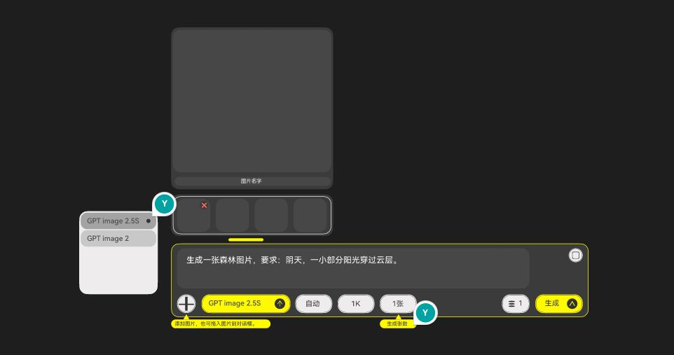

# 终末地风格项目与生图对话框设计调研

调研日期：2026-11-09。状态：**建议待采纳**，尚未变更现行设计规范或网站实现。

## 1. 结论与推荐方向

你的原型已经有终末地游戏界面的基础语言：深灰面板、浅灰胶囊、内描边、圆形图标片与高亮黄。建议沿着**游戏控件风格的生图工作台**继续细化，吸收官网风格的颜色分工和排版纪律。优先解决选中态可读性、黄色的优先级和参数含义，再调整圆角与装饰。

重点结论：

1. **终末地风格没有一套适用于所有界面的唯一规范。** 官网、游戏、云游戏账号界面及社区二次设计的形状和黄色取值不同。指定 DSH 主题的“全直角”是该作者的设计选择，不能据此判定你的胶囊按钮不符合风格。
2. **指定主题最值得参考的是语义令牌、前景与背景成对设计、分模式计算对比度。** 等高线、巨字、水印属于次一级的表现手法。
3. **原型整体并非文字对比度不足。** 提示词白字与底色为 9.29:1，控件深灰字与黄底为 7.62:1；真正需要先修的是模型菜单选中行，按原文件透明度合成约 3.37:1。
4. **原型存在产品语义问题。** 所选 GPT 模型旁的 `1K` 与当前接口能力不符；“1张”与右侧“1”的区别需要显式说明。视觉精修应同时解决这些问题。
5. **推荐保留 `#FFFA00`。** 没有必要仅为接近某个 DSH 主题而改成 `#FFF500`；应先收束黄色的使用范围。大面积中性色、少量信号黄，比某个精确黄值更影响整体观感。

本次仅调研和评审，未修改原设计文件。若采纳后绘制对照稿，操作位置应为 `design/对话框设计稿.figcraft` 内新建画布、复制原稿后修改，不覆盖原画布。该文件为用户提供的未跟踪稿件，本次不将它纳入提交。

## 2. 范围、方法与证据边界

- 检索公开 GitHub 仓库，读取指定提交的 README、设计文档、样式和相关控件实现；浏览作者提供的部分截图。没有安装主题或运行其安装、注入脚本。
- 深入分析指定项目及另外六个案例；另列一个有明确继承关系的增强层项目作为补充，不将其当作独立设计体系的重复佐证。
- 通过 FigCraft 只读打开 `对话框设计稿`，核对 `Page 2` 的图层、颜色、字体、尺寸及透明度；同时对照用户附图。打开时文档 `dirty=false`。
- 对比度采用 WCAG 相对亮度公式独立计算；透明色先与实际底色进行 sRGB 通道合成，再计算亮度。不以截图缩放后的观感代替原稿字号和色值。
- 社区文档中标为“官网实测”的数值，本文仍视为**作者测量结果**；本次没有独立在官网浏览器中重测。仓库代码中的实际令牌与本次独立计算值另行说明。
- 作者截图用于观察构图，不保证对应最新默认设置；尤其指定主题截图仍有圆角，不能用截图反推当前源码默认圆角。未验证任何主题在其宿主最新版本中的运行表现，也未开展用户测试。

## 3. 案例比较

### 3.1 总览

| 项目 | 已核对材料 | 风格与可借鉴点 | 对本项目的适用边界 |
| --- | --- | --- | --- |
| [ymh0000123/dsh-theme-endfield][S1]，指定项目 | 设计语言、CSS、调色板、对比度测试源码、两张截图 | 纸墨工业编辑风；亮暗语义令牌、信号色角色、低干扰纹理 | 借用规则；全直角不是游戏控件的唯一形态 |
| [icaruszezen/endfield-ui][S2] | 色彩、形状、圆角控件与浮层文档、主题 CSS、仓库页截图 | 区分官网与 Game 控件；记录取值来源等级；有圆角、胶囊和内描边实例 | **与你的原型形态最接近的补充资料**；不能把社区测量当官方设计规范 |
| [VBeatDead/ReEnd-Components][S3] | 令牌、Button、Select、Tooltip 源码、README | React/Tailwind/Radix；按钮变体、状态与浮层分层 | 适合学习组件结构；颜色和动效更接近作者的科幻演绎，不能整套照搬 |
| [rison114514/dsh-endfield-ui][S4] | README、主题 CSS、工作台截图 | 深色工作区与纸白输入区并置；字体分角色；工业工作台 | 可借鉴输入区与画布的层级分离；图片创作页不宜照搬背景人物和厚重装饰 |
| [Longxiangjunlin/dsh-endfield-theme][S5] | CSS、README、LICENSE/NOTICE、暗色截图 | 炭黑 HUD、切角、发丝线；明确记录菜单被裁切等实现问题 | 可借鉴切角装饰层与交互层分离；扫描线、背景图不适合覆盖生图结果 |
| [cloud-oc/endspace][S6] | 主分支 README，实际 `theme` 分支的样式与组件 | NotionNext 博客；内容排版、字族分工、明暗主题 | 适合阅读区域和响应式组织；整页比例缩放不宜直接移植到密集工具栏 |
| [leostudiooo/typst-touying-theme-endfield][S7] | Typst 主题源码、README、中文示例图 | 中性正文区、章节导航、局部黄、等高线留白 | 可借鉴清晰的信息层级；演示文稿尺寸不等于网页字号或触控尺寸 |

补充：[lannokaede/codex-theme-endfield][S8] 当前 README 描述的是 **ChatGPT Windows 客户端增强层**，不能仅凭仓库名称将其归为 Codex 皮肤。它明确借鉴 S1，使用 `#FFF500` / `#14D0D0`，支持减少动态效果和关闭装饰。README 顶部是矢量示意，作者明确说不是客户端实机截图；本次不把它当作运行效果验证。

### 3.2 指定 DSH 主题：值得迁移的是颜色角色

以下为该仓库实际设计文档与样式使用的值，**是社区主题的令牌，不是官方统一色板**。[设计语言][S1-design]、[主题 CSS][S1-css]

| 角色 | 亮色 | 暗色 | 对本项目的启示 |
| --- | --- | --- | --- |
| 页面底 | `#E8E8E2` | `#101110` | 页面、面板、浮层需要分角色，避免只定义一个“背景灰” |
| 面板 | `#F2F2EC` | `#181A18` | 面板层次可以很轻，边界与交互反馈补充识别 |
| 输入/沉底块 | `#DCDDD6` | `#1E201D` | 输入层与容器层分离，不依赖阴影堆叠 |
| 浮层 | `#F2F2EC` | `#1C1E1C` | 菜单需要自己的表面及文字色 |
| 正文 | `#101110` | `#F5F5F0` | 背景与文字一起切换 |
| 次要文字 | `#4A4C48` | `#898D89` | 必须在实际所在表面重新验算，不能只因叫“次要”就降透明度 |
| 信号黄 | `#FFF500` | `#FFF500` | 用作行动、选中、焦点，保持面积克制 |
| 黄系强调文字 | `#6B5D00` | `#FFF500` | 浅底上的黄字需要另一个深色令牌 |
| 可选青色 | `#14D0D0` | `#14D0D0` | 可作为整套替代主题，不能自然推导为黄青同时高亮 |

本次独立复算：`#101110` 字 / `#FFF500` 底为 **16.50:1**；白字 / 同黄底仅 **1.15:1**；黄字 / `#E8E8E2` 纸底仅 **1.07:1**。因此“黄底墨字”和“亮底深金字”应是两套明确配对。

该项目有[对比度检查源码][S1-test]，覆盖两种配色、多种表面及装饰合成强度；本次阅读了断言逻辑，没有运行其完整测试套件，不能将作者测试结果写成本项目验收通过。值得迁移的方法是：**每个前景色对实际底色计算，包括 hover、pressed、selected 与半透明叠加后的表面**。

其他可借鉴规则：数字使用等宽数字特性 `tabular-nums`；成功、警告、错误色不跟随品牌色切换；等高线与水印退在内容后面。作者对装饰对比度给出的约 1.06–1.6:1 是干扰强度经验区间，**不能用于正文或必要控件边界的合格判定**。

不建议迁移全局 `[class]` 圆角清零和宿主类名覆盖。你的项目掌握 React 源码，更适合在自己的组件与令牌里表达形状和状态。

### 3.3 endfield-ui：解释你的圆角为什么可以保留

S2 将官网型组件与 `Game` 圆角控件分开：[形状规则][S2-shape]、[圆角控件][S2-rounded]。

- 主库倾向直角面板、4px 微圆角按钮；Game 入口则有 `RoundedButton`、`RoundedSelect`、`RoundedToggle` 和圆形图标按钮。
- 圆角按钮文档包含浅底 `#F2F1EF`、文字 `#4D4D4D`、内部描边、图标圆片等细节，与你的原型有明显对应关系。
- 作者也记录云游戏页胶囊按钮、浮层和账号 SDK 卡片使用不同半径。这证明同一作品的不同产品表面存在差异；不证明任何半径混搭都能成立。
- 文档区分“实测、观察、社区、推断”。其中切角尺寸等属于推断，不宜转述为官方规定。

**建议：保留参数胶囊和图标圆片，但让同类控件共享高度、内描边、图标尺寸和圆角。** 大容器使用较小半径，参数胶囊使用接近半高的半径，缩略图另成一档。这样形成有意义的形状对比，不必将所有元素统一成方形。

### 3.4 ReEnd：看组件状态，谨慎采用它的色板

其实际主色变量为 HSL `48 100% 58%`，文件注释标称 `#FFD429`，比你的黄更暖。它提供 primary、secondary、ghost、danger 等按钮变体，Select 使用 Radix Portal，适合参考“行为与视觉分开”的实现方式。[令牌][S3-tokens]、[按钮][S3-button]、[选择器][S3-select]

但这不是无障碍认证：例如其危险按钮将白字压在 `#FF4757` 近似红底上，独立复算约 **3.34:1**，不满足普通字号文字 4.5:1 的目标。文件中还有蓝、青、紫、荧光绿和发光效果，适合特定信息展示，不宜全量带入生图输入区。

**建议：借鉴按钮变体、loading/disabled/focus 与浮层行为，不新增一套完整 UI 库依赖来替换现有组件。**

### 3.5 两套 DSH 工作台：借层级，不借装饰密度

S4 的 CSS 为聊天区与纸白输入区分别定义前景和背景，不依赖全局暗色文字令牌。字体也分为中文阅读、展示标题、数字三个角色。这说明深色页面里的局部浅色控件可以成立，关键是局部配对完整。[CSS][S4-css]、[作者截图][S4-shot]

S5 强调炭黑、信号黄和切角；实际 `--ef-y` 是 `#F2F013`，不能把注释提到的素材取样 `#F9F60C` 当作最终 UI 令牌。[CSS][S5-css]、[作者截图][S5-shot]

其中输入框源码明确记录：在包含菜单的容器上直接使用 `clip-path`，会裁掉向外展开的菜单；其改为伪元素绘制切角。这个问题与你的模型菜单、添加图片菜单直接相关。若以后加入切角，应只裁装饰底板，保证菜单与 tooltip 能越过输入区边界；页面边缘、滚动和放大状态都要核对。

对生图网站，图片的颜色与细节就是工作内容。背景人物、扫描线、覆盖图片的色罩或长时间闪烁会干扰审图。推荐将纹理留在空白背景，图片、输入文字、缩略图和菜单保持干净。

### 3.6 Endspace 与 Touying：借阅读层次

Endspace 的 `main` 分支主要是说明，实际源码位于 `theme` 分支。本次核对了后者：底色有 `#FAFAFA` / `#09090B`，黄有 `#FBFB45` / `#FEF08A`；字体按正文、等宽标签、展示标题分工。[样式][S6-css]

其 viewport hook 会动态改变根字号并限制在 14–24px，属于作者实现。生图工作台更适合固定可读字号、弹性宽度和控件换行，避免视口变窄时按钮、文本和命中区一起缩小。

Touying 源码采用 `#191919`、`#D9D9D9`、`#E6E6E6` 和 `#FFFA01` 等色阶。中文内容页保持阅读区中性，黄主要用于导航与强调，等高线退入背景。[主题源码][S7-code]、[中文内容示例][S7-shot]

适合迁移的是稳定的边距、标题层级、低干扰背景；不应将幻灯片里的巨大标题或每页导航机械套进输入框。

## 4. 对现有原型的具体评审

附图是设计参考，包含悬停提示和青色标记，不能直接视为正式页面截图。原文件中未发现对应青色 `Y` 图层，本次将其按附图标注处理，不将其纳入产品色板。

### 4.1 已有基础应当保留

- 上方结果预览、中间参考图、下方输入区的顺序符合图片创作流程。
- 左侧配置、右侧费用与生成操作的分组方向明确。
- 主按钮黄底深字、参数浅底深字，基本配色可读，不需要推倒重做。
- 16px 提示词与 14px 控件标签可作为下一版基线；附图经过缩放，不能据此要求所有文字普遍放大。

### 4.2 原稿测量与优先级

| 项目 | 原文件事实 | 判断与建议 | 优先级 |
| --- | --- | --- | --- |
| 模型菜单选中项 | `#363636` 以 40% 叠在 `#EEECEC` 上，文字 `#4D4D4D`，合成约 3.37:1 | 先修可读性；保持当前底色时将文字改为 `#333333`，按近似合成底约 5.02:1；或整体采用深菜单浅字 | P0 |
| 参数有效性 | 原型所选 `GPT image 2.5S` 旁显示 `1K` | 当前 GPT 接口不提供分辨率控件；该项应条件隐藏或说明模型不支持，不能暗示可选生效 | P0 |
| 张数与费用 | `1张`，右侧三横图标加 `1`；原文件将后者命名为“积分用量” | 改为可读的“预计消耗 1 积分”，张数用“张数 1”；费用应来自当前服务端报价 | P0 |
| 黄色分工 | 模型、生成按钮、外框、附件区下短条、两处 tooltip 都用 `#FFFA00` | 默认态只让“生成”保持实心黄；模型默认中性，选中用记号；整圈黄外框留给聚焦态 | P1 |
| 内外边界 | 输入底 `#474747` / 外板 `#3B3B3B` 为 1.21:1；附件白边 / 外板约 9.52:1 | 一个边界偏弱，另一个过强；用明确但克制的输入识别线与中性附件边界平衡，按其功能决定门槛 | P1 |
| 字号 | 提示词 16px、控件 14px、图片名和 tooltip 10px | 前两者保留；图片名与 tooltip 改为 12–13px，长文件名截断并可查看完整内容 | P1 |
| 命中区 | 参数高约 36.23、扩展按钮约 27.17、删除图形约 10.41 设计单位 | 落地时核对 CSS 像素；小图标外加透明按钮盒，常用控件高 36–40px，触屏优先约 44px | P1 |
| 菜单位置 | 附图菜单在模型触发器左上方，原稿菜单宽 152、高 161，两行高各 32 | 展开时贴近触发器，宽度至少容纳模型全名；短列表按内容收高，不留明显空底 | P1 |
| 圆角和内描边 | 主容器与缩略图约 15，胶囊约 16，普遍有双层轮廓 | 保留游戏式胶囊；减少大容器圆角，并统一内描边粗细与内缩距离 | P2 |

原稿关键图层：输入底 `124`、提示词 `125`、黄外框 `126`、模型触发器 `92`、菜单 `163`、选中底 `158`、菜单字 `160`、图片名 `148`、tooltip `139/149`。这些 ID 仅用于定位本次原稿，复制后应以新节点为准。

### 4.3 对比度：哪些是真问题，哪些不是

| 配对 | 本次计算 | 解释 |
| --- | --- | --- |
| 白色提示词 / `#474747` | 9.29:1 | 正文对比度充足 |
| `#4D4D4D` / `#FFFA00` | 7.62:1 | 当前黄色按钮文字可读 |
| `#4D4D4D` / `#EEECEC` | 7.18:1 | 当前浅色参数标签可读 |
| `#4D4D4D` / 菜单选中合成底 | 约 3.37:1 | 14px 普通文字应修正 |
| `#4D4D4D` / 菜单未选中合成底 | 约 5.05:1 | 普通文字达标；出现选中后反而更难读的问题 |
| 删除红 `#FF6B61` / `#474747` | 3.33:1 | 对图形本身可达到 3:1；但可点击面积仍需单独解决 |
| 黄外框 / `#3B3B3B` | 10.10:1 | 边界非常突出；这是注意力分配问题，不是对比度越高越好 |
| 输入底 / 外板 | 1.21:1 | 若仅作装饰分层不必强求 3:1；若它是识别可编辑区域的必要线索，应补充足够对比的功能边界 |

计算透明度时：选中底约为 `(164.4,163.2,163.2)`，未选中约为 `(201.2,199.6,199.6)`。底色本身的 40%/20% 不是文字透明度；若忽略合成而直接拿 `#363636` 算，会得出错误结论。

普通文字以 4.5:1 为目标；必要图标、控件识别线索和状态标记按适用场景以 3:1 为目标。装饰分隔线无需全部变为高对比实线。10px 字号即使对比度合格也不一定易读。

### 4.4 推荐的控件调整

**输入区。** 保留上方文字、下方工具栏两层结构，让文本区尽量横向铺满，扩展按钮放入右上角固定动作区。当前文字区右侧留有较宽空带；只有确需放置操作时保留。默认中性边界，键盘聚焦后才显示黄焦点环，避免原型截图中的“永久聚焦感”。

**模型选择。** 触发器保持“模型名 + 向下箭头”，展开可翻转方向；生成按钮保留“生成 + 向上箭头”。现在模型与生成都用向上箭头，动作含义容易混淆。菜单用勾选标记说明当前项，hover、selected、keyboard focus 三种状态分开设计。菜单项目多时再设置最大高度滚动，打开方向根据视口空间调整。

**参数组。** 用“比例 自动”“张数 1”这样的标签与值配对，至少在首用及窄屏之外的常规宽度下清楚表达含义。“自动”不能只靠 tooltip 解释。分辨率仅在对应模型及模式支持时显示；有参考图时依照现行契约显示锁定状态或隐藏无效选项，不能允许用户选择但请求不生效。

**费用。** “预计消耗 N 积分”靠近生成按钮，视觉降一级；与“张数 N”明确区分。价格加载、报价改变、余额不足、冻结中、最终结算需要自己的文案。不要为风格化把积分改称“电力”，除非产品明确采用这种命名。

**参考图条。** 原稿只画了四格，正式能力最多六张，下一版应覆盖六图、横向溢出、上传中和失败；没有参考图时收起空轨道，通过“添加参考图”引导。已有参考图可显示 `参考图 2/6`，缩略图建议 56–64px；保留原始图片比例的裁切逻辑，并支持点开查看。红色删除叉位于明确按钮底片中，扩大命中区；键盘聚焦和触屏也能发现它。

**附件条下的黄短条。** 从静态稿无法确认它是拖拽把手、进度还是当前项指示。若是把手，用中性灰并提供实际可拖区域；若是进度，配状态文字；若只是装饰，可去除。不要让一条黄线承担不明确的功能。

**Tooltip。** 改为中性深底浅字，黄色留给主行动。文案字号 12–13px，键盘聚焦也能触发，Esc 可关闭；鼠标移入提示时不应立即消失。像“可拖入参考图”这样的核心说明，不应只存在于 hover；空态直接展示简短提示即可。附图同时展示多个 tooltip 可作为状态板，默认画面只展示实际触发的一处。

**结果卡。** 图片名移入更易读的 12–13px 信息行；为长文件名、多张生成、失败/处理中和下载操作保留位置。大图和参考图的角色靠布局与标签区分。图像表面不叠扫描线、等高线、主题色滤镜或装饰水印。

**扩展编辑。** 右上角按钮使用可识别的“展开”图标和可访问名称；展开编辑器应保留当前输入及返回焦点。只有展开为真正模态窗口时才采用 dialog 焦点约束，常驻输入区无需整体声明为模态对话框。

## 5. 建议色板与尺寸起点

以下是针对本网站的**新建议**，不声称为任何项目或官方原值。为兼容你现有原型与图片审阅场景，优先保留纯灰和 `#FFFA00`，无需增加偏绿底色。

| 语义 | 深色建议 | 浅色备选 | 使用规则 |
| --- | --- | --- | --- |
| 页面底 | `#1E1E1E` | `#E8E8E2` | 大面积背景 |
| 主容器 | `#2A2A2A` | `#F2F2EC` | 输入区、结果信息容器 |
| 输入/次控件底 | `#333333` | `#DCDDD6` | 与主容器形成轻层次 |
| 主文字 | `#F2F2F2` | `#191919` | 提示词、重要结果信息 |
| 次文字 | `#B8B8B8` | `#4D4D4D` | 参数标题、说明 |
| 可读弱文字 | `#A3A3A3` | `#626262` | 元数据；仍逐表面检查 |
| 装饰边线 | `#525252` | `#B6B8B3` | 只作分隔，不单独承担必要控件识别 |
| 功能边界候选 | `#808080` | `#737373` | 必须依赖边界才能识别的部位，再按底色验算 |
| 信号色 | `#FFFA00` | `#FFFA00` | 主按钮、聚焦、有限的选中记号 |
| 黄底文字 | `#191919` | `#191919` | 避免白字黄底 |
| 强调文字 | `#FFFA00` | `#6B5D00` | 亮暗分别取值 |

独立复算示例：`#F2F2F2` / `#333333` 为 **11.29:1**；`#B8B8B8` / `#333333` 为 **6.37:1**；`#A3A3A3` / `#333333` 为 **5.01:1**；功能边界 `#808080` / `#333333` 为 **3.20:1**；`#191919` / `#FFFA00` 为 **15.85:1**。这些结果只对应表中配对，不覆盖透明度、其他底色或所有状态；浅色备选也需在被采纳后的实际组合中完整核对。

尺寸建议以 1 设计单位约等于 1 CSS px 的新稿为起点，落地后再以浏览器确认：

- 间距：4/8/12/16/24；容器内边距 12–16，相关控件间距 8，分组间距 16。
- 主容器半径先试 8px，缩略图 6px，参数胶囊使用半高半径；它们是本项目建议，并非官方取值。
- 参数高 36–40px，生成按钮高 40px；图标统一 16–18px，图标圆片约 20–24px，双边线只保留一套一致规格。
- 正文 16px / 24px 行高；控件 14px；提示与元数据 12–13px。数字开启 `tabular-nums`，中文阅读区保留常规无衬线；等宽字体只用于数字和少量结构标签。
- 桌面先按约 800px 的输入区验证；窄屏改为参数换行或“参数”面板，费用与生成保持易见，不整体等比缩小。移动端考虑底部安全区和软键盘。
- hover/focus 动效以 120–180ms 为起点，菜单入场约 160–220ms；遵循减少动态效果偏好。无需开屏、持续扫描或大面积闪烁。

## 6. 下一版原稿建议验证的画面

以下为待采纳的设计工作范围，不代表已实现。若开始绘制，先在同文件复制出新画布，并保留原图和用户未保存内容。

| 画面/情境 | 需要判断的行为 |
| --- | --- |
| 默认与输入聚焦 | 默认只突出生成；聚焦环清楚且不裁切 |
| 模型菜单 | 当前项、hover、键盘焦点分离，菜单贴近触发器且不越界；长模型名可读 |
| 参数适配 | GPT 无分辨率；Gemini 按支持项显示；参考图模式锁定或隐藏无效参数 |
| 无附件、六附件、上传失败 | 参考图数量与删除操作明确，轨道不挤压文字区 |
| 报价加载与余额不足 | 不把未知价格当 0；费用与张数能立即区分 |
| 提交中、排队、部分成功、失败、结果未知 | 保留输入，显示实际状态；不凭主题动效暗示已经完成，不自动重试计费请求 |
| 390px 窄屏与桌面放大 | 参数可操作，菜单与 tooltip 不裁切；图标命中区保持足够尺寸 |
| 键盘与减少动态效果 | Tab 顺序合理、Esc 关闭浮层、关闭后回到触发器，静态状态仍可理解 |

功能约束依据现行[接口契约](../../docs/api-contract.md)：最多六参考图、一次 1–4 张输出；GPT 不展示质量与分辨率；附件模式采用自动比例和默认参数；未知结果先查历史；写请求不自动重试。关于“取消生成”或“失败重试”等新动作，本报告不假设当前接口已支持。

## 7. 标准与复算方法

判断标准来自 W3C：

- [WCAG 2.2 文字对比度](https://www.w3.org/WAI/WCAG22/Understanding/contrast-minimum.html)：普通文字 4.5:1，大文字 3:1；本稿 10/14/16px 均按普通文字检查。
- [非文本对比度](https://www.w3.org/WAI/WCAG22/Understanding/non-text-contrast.html)：识别控件与状态所需的视觉信息按适用条件达到 3:1；不要求每条装饰分隔线都达标。
- [目标尺寸最小值](https://www.w3.org/WAI/WCAG22/Understanding/target-size-minimum.html)：AA 基线为 24×24 CSS px，存在间距等例外。44px 是这里为触屏提出的舒适目标，不是将 AA 门槛误写为 44px。
- [悬停或聚焦时的内容](https://www.w3.org/WAI/WCAG22/Understanding/content-on-hover-or-focus.html)：提示内容应可关闭、可悬停且持续到合适时机。

复算公式：sRGB 通道先除以 255；若 `c ≤ 0.04045`，线性值为 `c/12.92`，否则为 `((c+0.055)/1.055)^2.4`。相对亮度 `L = 0.2126R + 0.7152G + 0.0722B`，对比度为 `(较亮L+0.05)/(较暗L+0.05)`。本稿透明背景按 `C = α×前层 + (1−α)×底层` 合成；表中小数保留两位，临界值不以四舍五入代替原值判断。

## 8. 来源快照与复用边界

所有链接访问日期均为 2026-11-09，仓库源文件链接固定到本次提交。以下短 SHA 便于复核，不依赖后续默认分支变化。

| 编号 | 仓库与提交 | 复核入口 |
| --- | --- | --- |
| S1 | ymh0000123/dsh-theme-endfield `903f5fb` | [README][S1]、[设计语言][S1-design]、[CSS][S1-css]、[测试源码][S1-test] |
| S2 | icaruszezen/endfield-ui `68c8117` | [README][S2]、[色彩][S2-color]、[形状][S2-shape]、[圆角控件][S2-rounded]、[浮层][S2-overlay] |
| S3 | VBeatDead/ReEnd-Components `959fc10` | [README][S3]、[令牌][S3-tokens]、[按钮][S3-button]、[选择器][S3-select] |
| S4 | rison114514/dsh-endfield-ui `d9d5c72` | [README][S4]、[CSS][S4-css]、[作者截图][S4-shot] |
| S5 | Longxiangjunlin/dsh-endfield-theme `0530341` | [README][S5]、[CSS][S5-css]、[作者截图][S5-shot]、[LICENSE][S5-license]、[NOTICE][S5-notice] |
| S6 | cloud-oc/endspace 说明 `e1dfc2f`，theme `986dde8` | [README][S6]、[实际样式][S6-css]、[缩放实现][S6-scale] |
| S7 | leostudiooo/typst-touying-theme-endfield `4a7427e` | [README][S7]、[主题源码][S7-code]、[中文内容示例][S7-shot] |
| S8 | lannokaede/codex-theme-endfield `fe29447` | [README][S8]、[默认配置][S8-config] |

代码许可证与美术、字体授权应分开看：S1 明确将部分素材排除在 MIT 之外；S5 的 LICENSE 明确只将代码与样式纳入 MIT，官方美术不在其中；S2 的 Game 入口存在单独说明的官方素材；S4 本次读取的目录未发现根 LICENSE，不能默认按 MIT 复制；S7 README 还提示 Gilroy 为商业字体。本文仅提炼设计规则与引用出处，不将任何主题的游戏图、标志、音效、字体导入本网站。

本任务保留了用户附图以维持报告上下文。下载的第三方源码、作者截图和中间计算只留在忽略提交的 `outputs/research/2026-11-09-endfield-dialog/`，不是网站产物或共享规范。报告本身包含复算方法与稳定来源，理解结论不依赖这些本地临时文件。

[S1]: https://github.com/ymh0000123/dsh-theme-endfield/blob/903f5fb59b77ca158f6e35e417bd23198d174057/README.md
[S1-design]: https://github.com/ymh0000123/dsh-theme-endfield/blob/903f5fb59b77ca158f6e35e417bd23198d174057/docs/design-language.md
[S1-css]: https://github.com/ymh0000123/dsh-theme-endfield/blob/903f5fb59b77ca158f6e35e417bd23198d174057/src/styles/theme.css
[S1-test]: https://github.com/ymh0000123/dsh-theme-endfield/blob/903f5fb59b77ca158f6e35e417bd23198d174057/test/palette-contrast.test.js
[S2]: https://github.com/icaruszezen/endfield-ui/blob/68c81171caa644ed73e98cb1d13c78439930c1f6/README.md
[S2-color]: https://github.com/icaruszezen/endfield-ui/blob/68c81171caa644ed73e98cb1d13c78439930c1f6/docs/design/foundations/color.md
[S2-shape]: https://github.com/icaruszezen/endfield-ui/blob/68c81171caa644ed73e98cb1d13c78439930c1f6/docs/design/foundations/shape.md
[S2-rounded]: https://github.com/icaruszezen/endfield-ui/blob/68c81171caa644ed73e98cb1d13c78439930c1f6/docs/design/game/rounded-controls.md
[S2-overlay]: https://github.com/icaruszezen/endfield-ui/blob/68c81171caa644ed73e98cb1d13c78439930c1f6/docs/design/components/overlay.md
[S3]: https://github.com/VBeatDead/ReEnd-Components/blob/959fc100982be7cd095062cf8371d2f9f523c66b/README.md
[S3-tokens]: https://github.com/VBeatDead/ReEnd-Components/blob/959fc100982be7cd095062cf8371d2f9f523c66b/src/styles/variables.css
[S3-button]: https://github.com/VBeatDead/ReEnd-Components/blob/959fc100982be7cd095062cf8371d2f9f523c66b/src/components/ui/button.tsx
[S3-select]: https://github.com/VBeatDead/ReEnd-Components/blob/959fc100982be7cd095062cf8371d2f9f523c66b/src/components/ui/select.tsx
[S4]: https://github.com/rison114514/dsh-endfield-ui/blob/d9d5c722cdb63e8c78d455af5a4896f7c3817cc8/README.md
[S4-css]: https://github.com/rison114514/dsh-endfield-ui/blob/d9d5c722cdb63e8c78d455af5a4896f7c3817cc8/endfield-ui-plugin/theme.css
[S4-shot]: https://github.com/rison114514/dsh-endfield-ui/blob/d9d5c722cdb63e8c78d455af5a4896f7c3817cc8/dsh-packaged-final.jpg
[S5]: https://github.com/Longxiangjunlin/dsh-endfield-theme/blob/053034141117920550cdd40df2da5def6c65630b/README.md
[S5-css]: https://github.com/Longxiangjunlin/dsh-endfield-theme/blob/053034141117920550cdd40df2da5def6c65630b/client/theme.css
[S5-shot]: https://github.com/Longxiangjunlin/dsh-endfield-theme/blob/053034141117920550cdd40df2da5def6c65630b/preview/dark.jpg
[S5-license]: https://github.com/Longxiangjunlin/dsh-endfield-theme/blob/053034141117920550cdd40df2da5def6c65630b/LICENSE
[S5-notice]: https://github.com/Longxiangjunlin/dsh-endfield-theme/blob/053034141117920550cdd40df2da5def6c65630b/NOTICE.md
[S6]: https://github.com/cloud-oc/endspace/blob/e1dfc2f961e5d1babd4f952a522e5d398c1ba763/README.md
[S6-css]: https://github.com/cloud-oc/endspace/blob/986dde8cb738f65c17d152e47b0be90e90f44508/style.js
[S6-scale]: https://github.com/cloud-oc/endspace/blob/986dde8cb738f65c17d152e47b0be90e90f44508/components/useViewportScale.js
[S7]: https://github.com/leostudiooo/typst-touying-theme-endfield/blob/4a7427e024f7a896736d6b965a917cdc7bb6ae9b/README.md
[S7-code]: https://github.com/leostudiooo/typst-touying-theme-endfield/blob/4a7427e024f7a896736d6b965a917cdc7bb6ae9b/src/lib.typ
[S7-shot]: https://github.com/leostudiooo/typst-touying-theme-endfield/blob/4a7427e024f7a896736d6b965a917cdc7bb6ae9b/img/zh/page-7.png
[S8]: https://github.com/lannokaede/codex-theme-endfield/blob/fe29447785250a6a4c57eec43c2680c5f758965b/README.md
[S8-config]: https://github.com/lannokaede/codex-theme-endfield/blob/fe29447785250a6a4c57eec43c2680c5f758965b/src/enhanced-config.mjs
